# Token Anxiety


A macOS menu bar app that shows how much of your AI plans you have used: the five-hour and weekly windows of each service, always in sight. Click it for a Liquid Glass panel with the details: when each window resets, how fast you are spending, per-model limits, today's tokens and how full your live Claude Code sessions are.

A Statistics window reads Claude Code's and Codex's own logs to show where your tokens go, by day, hour, project, model and session, what they would cost through the API, and 51 achievements to unlock along the way.

It speaks English and Spanish, following your Mac's language.

<p align="center">
  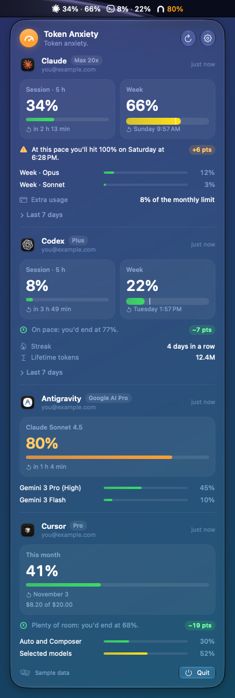
  <br>
  <sub>With the sample data from <code>--demo</code>.</sub>
</p>

## What it tracks

Services are found on their own, through the session each app already keeps on your Mac. Any of them can be hidden, or kept out of the menu bar, in Settings.

| Service | Where the figures come from | What it shows |
| --- | --- | --- |
| **Claude** (Pro, Max) | Claude Code's session in the Keychain, against the endpoint its `/usage` command reads | 5-hour session, week, Opus and Sonnet weeks, extra usage |
| **ChatGPT / Codex** | Codex itself (`codex app-server`, which manages its own session) | 5 hours and week (the Free plan has a monthly limit), credits, streak and tokens per day |
| **Antigravity** | Its local language server, only while the app is open | Each model's quota |
| **Cursor** | The Cursor app's session, against its usage dashboard | This month's usage (no 5-hour or weekly window, so by default it only shows in the panel) |

In the menu bar each service shows its icon and two figures: `34% · 61%` means 34% of the five-hour window and 61% of the week. Settings has two more styles (double bars, figure + bar), and figures turn orange and red past the alert thresholds.

### Extras

- **Alerts**: a notification at 80% and 95% (both thresholds can be changed), another when a window runs out, and another when the quota comes back.
- **Weekly pace**: compares what you have spent with an even spend and tells you whether, at this pace, you will hit 100% before the week resets.
- **History**: keeps the figures on your Mac and draws the last 7 days.
- **Today and context**: under Claude and Codex, today's tokens and their API value; under Claude, how full the context window of each live Claude Code session is.
- **Open at login**: turned on by itself the first time the app is opened from Applications.

## Statistics

Open it from the chart button in the panel, or from the menu bar item's right-click menu. Every section shares a period (today, 7, 30 or 90 days, or everything), a service filter and a **$** button that turns token counts into what they would cost through the API.

| | |
| --- | --- |
| 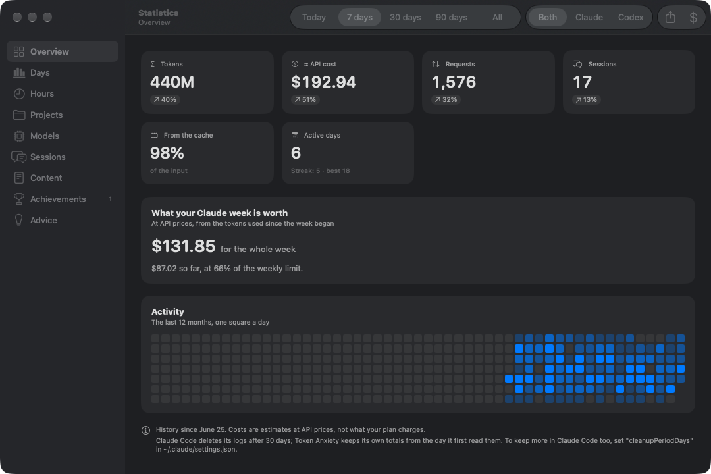 | 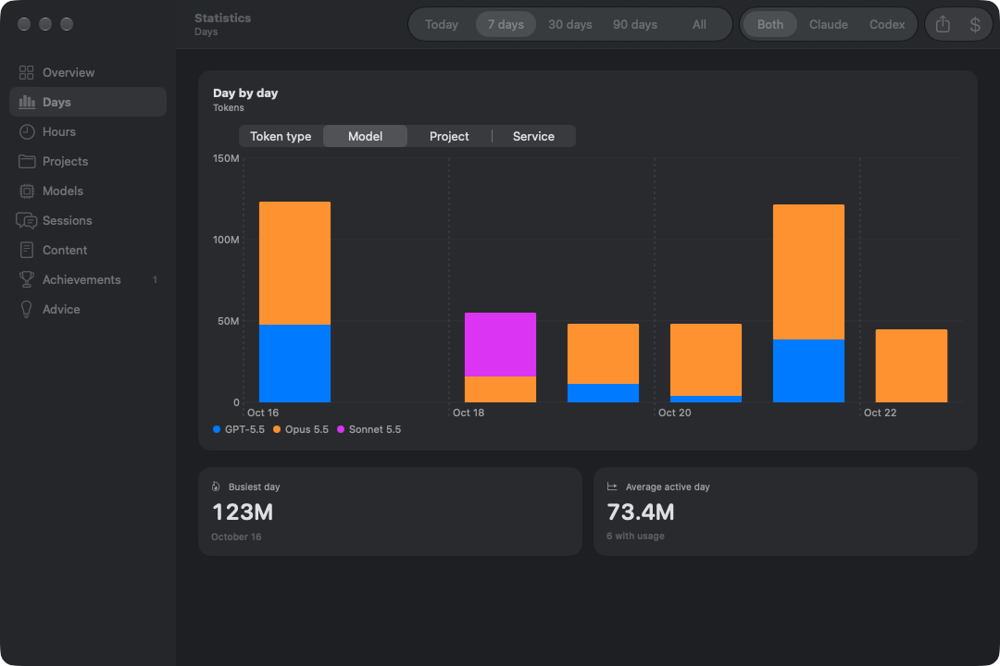 |
| **Overview**: headline figures against the previous period, what your plan's current week is worth at API prices, streaks and a year of activity. | **Days**: tokens or cost per day (hour by hour today), stacked by model, token type, project or service. |
| 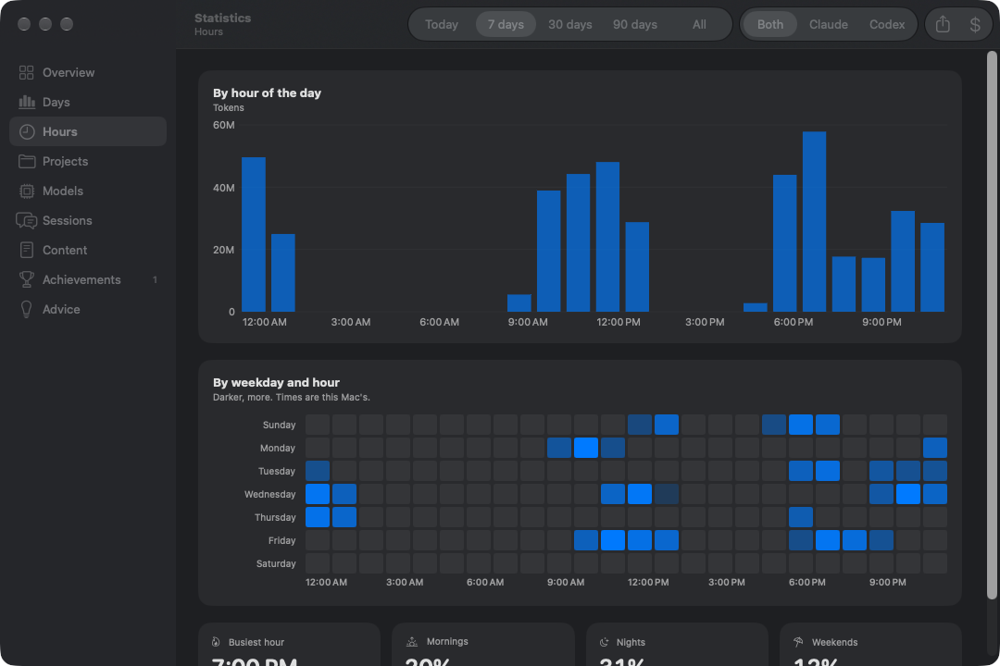 | 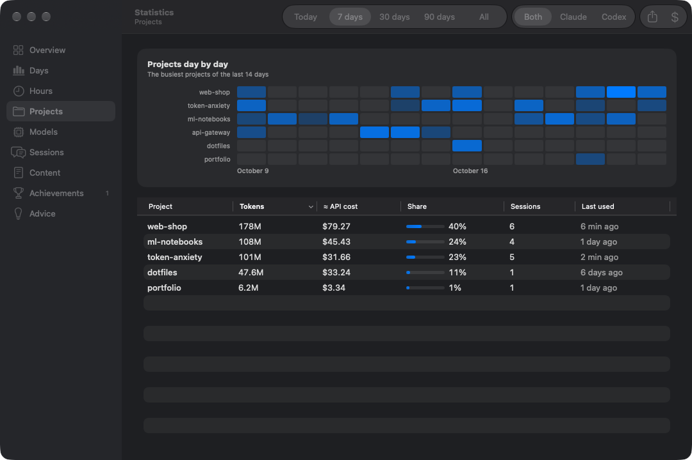 |
| **Hours**: when you work, by hour and by weekday and hour. | **Projects**: each git repository (worktrees folded in), day by day and in a sortable table. |
| 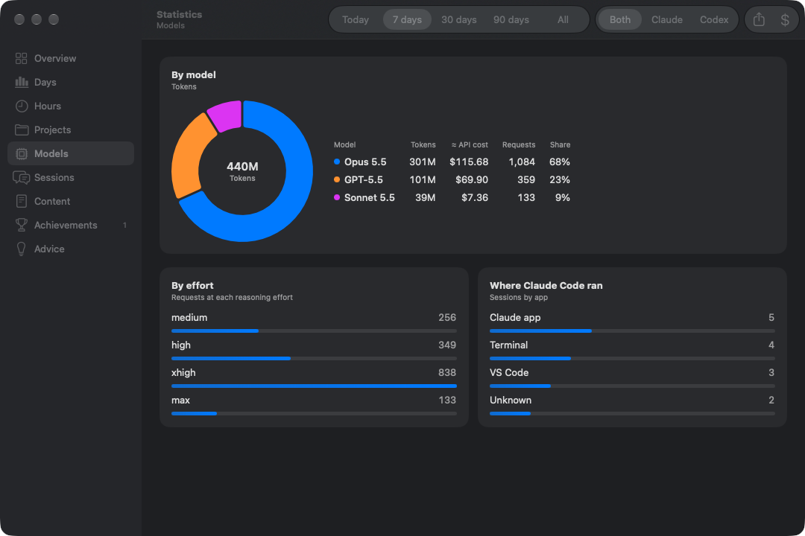 | 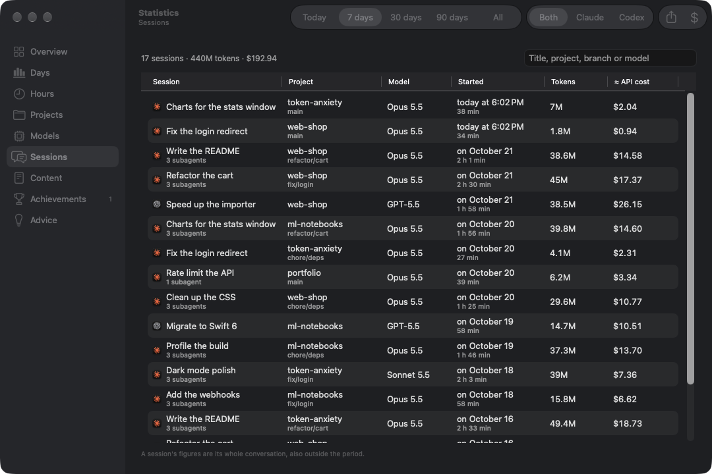 |
| **Models**: share by model, requests by reasoning effort, and where Claude Code ran (app, terminal, VS Code). | **Sessions**: every conversation with its project, branch, model, length, subagents, tokens and cost. |
| 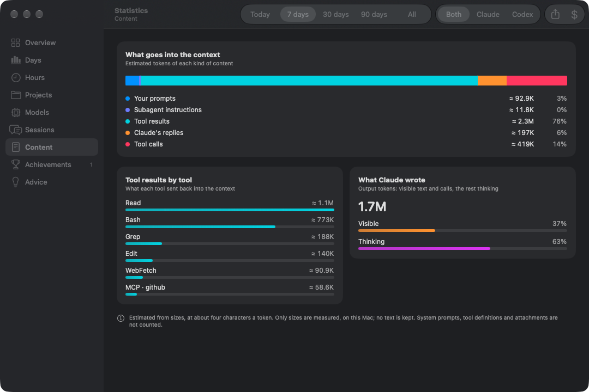 | 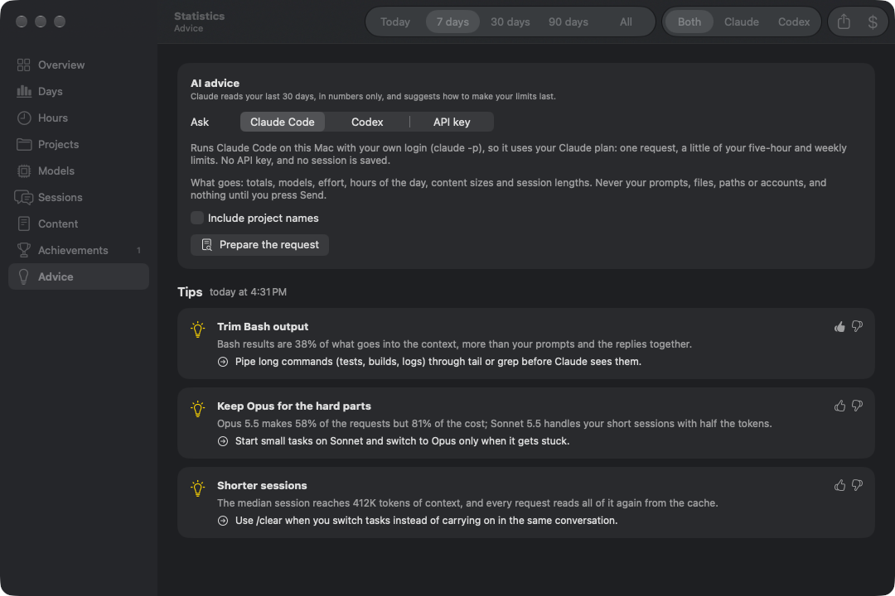 |
| **Content**: what fills the context (your prompts, tool results by tool, Claude's replies) and how much of the output is thinking, estimated from sizes. | **Advice**: optional tips from Claude or Codex on making your limits last, through the plans you already pay for (see below). |

The figures come from the logs Claude Code (`~/.claude/projects`) and Codex (`~/.codex/sessions`) already write on your Mac. A response written several times in a log, or copied into a forked session, counts once. Claude Code deletes its logs after 30 days, so Token Anxiety keeps its own totals from the day it first reads them (to keep more in Claude Code too, set `cleanupPeriodDays` in `~/.claude/settings.json`). Costs are estimates at API prices, not what your plan charges.

### Achievements

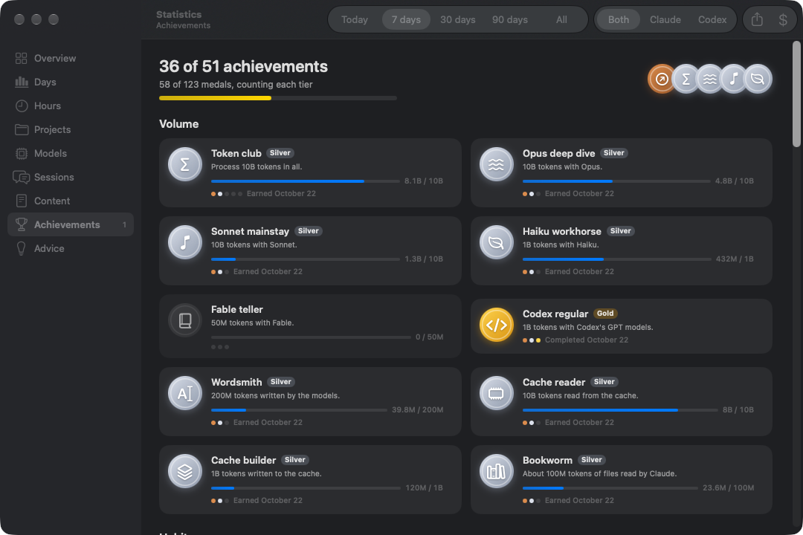

51 achievements, most with bronze to legendary tiers: token clubs, streaks, night owls, model rainbows, subagent swarms, the most expensive week on paper… and some about living with limits, like *Saved by the bell* (the five-hour window resets while you're at 95% or more) or *Not a crumb left* (a week ends at 90% or more without ever reaching 100%). A few are secret. New ones arrive as a notification and a dot on the panel's chart button.

### Share card

Make an image of your year or your achievements and save it as a PNG, from the share button in the Statistics window. It has no project names or accounts, and nothing is uploaded.

<p align="center">
  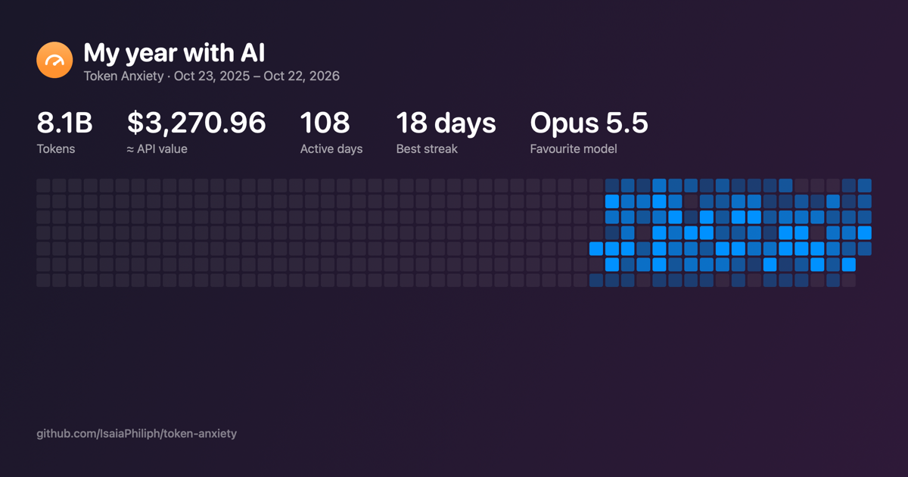
  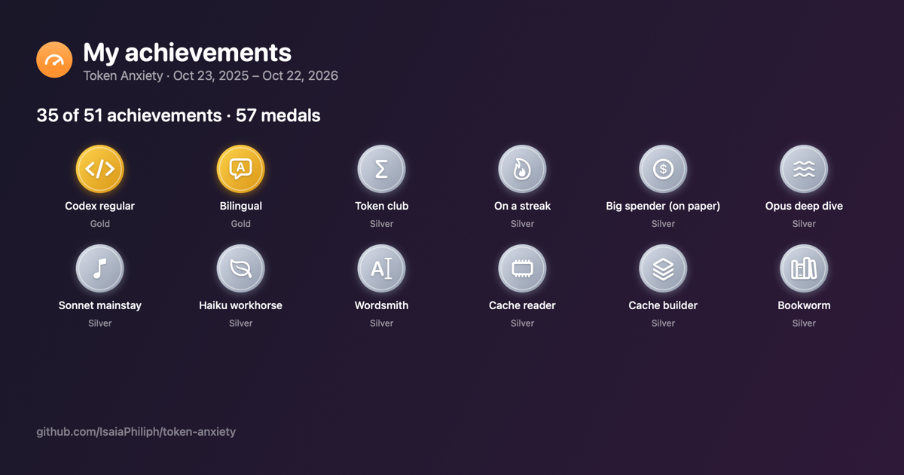
</p>

### AI advice

Statistics › Advice asks for tips on making your limits last, from your last 30 days, in one of three ways:

- **Claude Code** (the default when it is installed): runs `claude -p` on your Mac with your own login, so it uses your Claude plan, one request's worth of your limits. It runs with no tools, MCP servers or hooks, in an empty folder, and saves no session.
- **Codex**: runs `codex exec` with your ChatGPT login, the same way (`--ephemeral`, read-only).
- **API key**: your own Anthropic API key, saved in the Keychain from Settings › Statistics, billed to your API account (a few cents).

The plans' tools are run as they are meant to be scripted; Token Anxiety never takes their session tokens to call the API itself (Anthropic doesn't allow a subscription's token in other apps). Only aggregates are sent (totals, models, effort, hours of the day, content sizes, session lengths), never prompts, files, paths or accounts, and project names only if you tick the box. You see the exact request or command first, and nothing runs until you press Send.

## Install

Token Anxiety needs macOS 26 or later. There are no prebuilt downloads yet: build it with Xcode 26 or later (or its command line tools).

```bash
git clone https://github.com/IsaiaPhiliph/token-anxiety.git
cd token-anxiety
scripts/build-app.sh --install
```

This builds a release version, signs it for your Mac (ad hoc), copies it to `/Applications` and opens it.

## Privacy

- Sessions are read on your Mac, and each token is only sent to its own service (Anthropic, OpenAI, Cursor). Antigravity is asked on `127.0.0.1`.
- Nothing is collected or sent anywhere else: there are no analytics.
- Claude Code's session lasts 8 hours, and only the `claude` command renews it. When it has expired, Token Anxiety renews it the way Claude Code does and saves it back in the same Keychain item, leaving every other field alone, so Claude Code keeps working. This can be turned off in Settings.
- Claude Code's and Codex's logs are only read, never changed. From them the app keeps token counts, models, times, project and branch names and session titles; with content analysis on (Settings › Statistics), the sizes of prompts, tool results and replies, never their text.
- Everything stays in `~/Library/Application Support/TokenAnxiety/`: `state.json` (the latest figures and their history), `usage/usage.json` (the usage history), `achievements.json` and `advice.json`.
- AI advice is the only feature that sends anything about your usage: aggregates only, through Claude Code, Codex or your API key, after you have read the exact request and pressed Send.

## Troubleshooting

- **Claude: "Claude Code can no longer renew its session"**: Claude Code's saved session is no longer valid. Run `claude` in a terminal and `/login`; the app keeps it alive from then on.
- **Antigravity: "Open Antigravity"**: it only gives its quota while the app is open.
- **Statistics are empty**: they come from Claude Code's and Codex's logs on this Mac, so use either and come back. History older than Claude Code's 30 days can't be recovered.
- **No alerts show up**: Settings › Alerts shows a line when macOS blocks them or keeps them off screen, with a button that opens the right pane of System Settings. "Send a test alert" shows what they look like.
- None of these services has a public usage API. If one changes its format, that service shows a warning until Token Anxiety catches up, without affecting the others. Please [open an issue](https://github.com/IsaiaPhiliph/token-anxiety/issues) if you see one.

## Development

```bash
CONFIG=debug scripts/build-app.sh --open --demo --open-panel            # sample data, panel open
CONFIG=debug scripts/build-app.sh --open --demo --open-stats achievements   # the Statistics window
swift test                                                               # parsers, ledger, pace, alerts, achievements
APP="build/Token Anxiety.app/Contents/MacOS/TokenAnxiety"
"$APP" --print --debug                # every service, once
"$APP" --print --stats --days 7       # what the local logs add up to
"$APP" --print --advice --engine claude-code --demo   # the exact advice command (--send runs it)
"$APP" --demo --export-card card.png  # a share card (add --achievements for the other one)
```

`--print` asks every service once and prints the figures (never tokens or emails); `--debug` adds each step. See [CONTRIBUTING.md](CONTRIBUTING.md) for how the code is laid out, how to add a service and how to translate the app.

## Disclaimer

Token Anxiety is an independent project. It is not affiliated with or endorsed by Anthropic, OpenAI, Google or Anysphere (Cursor). It reads undocumented endpoints that may change at any time.

## License

[MIT](LICENSE)
