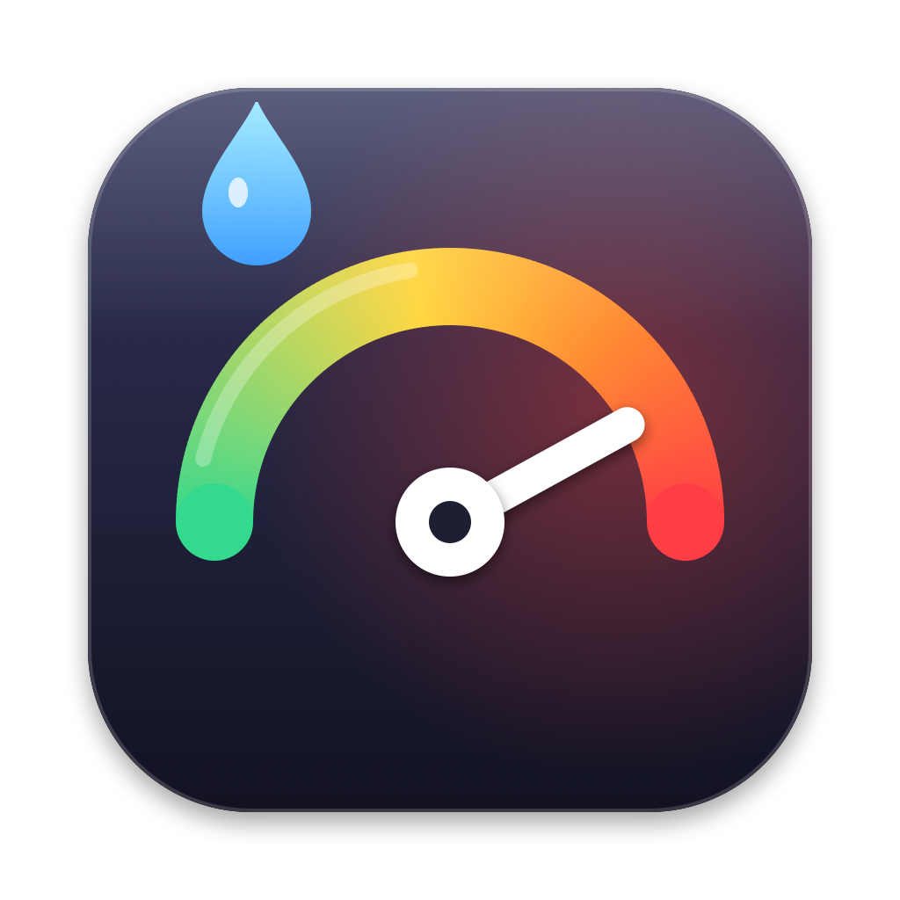

# Token Anxiety

App de la barra de menús de macOS que enseña cuánto llevas gastado de tus planes de IA: la ventana de 5 horas y la semanal de cada servicio, siempre a la vista. Al pinchar se abre un panel de Liquid Glass con el detalle: cuándo se renueva cada ventana, a qué ritmo gastas, los límites por modelo y una gráfica de los últimos 7 días.



## Qué mide

Los servicios se detectan solos con la sesión que ya tiene cada app en este Mac; en Ajustes se puede ocultar cualquiera o sacarlo de la barra.

| Servicio | De dónde lo saca | Qué enseña |
| --- | --- | --- |
| **Claude** (Pro, Max) | La sesión de Claude Code del llavero, contra el mismo endpoint que usa `/usage` | Sesión de 5 h, semana, semana de Opus y de Sonnet, uso extra |
| **ChatGPT / Codex** | El propio Codex (`codex app-server`, que gestiona su sesión) | 5 h y semana (el plan Free tiene un límite mensual), créditos, racha y tokens por día |
| **Antigravity** | Su servidor local, solo mientras la app está abierta | Cuota de cada modelo |
| **Cursor** | La sesión de la app de Cursor, contra su panel de uso | Uso del mes (no tiene ventana de 5 h ni semanal, así que por defecto solo sale en el panel) |

En la barra de menús cada servicio sale con su icono y dos cifras: `34% · 61%` es 34 % de la ventana de 5 h y 61 % de la semana. Hay otros dos estilos en Ajustes (barras dobles, cifra + barra), y las cifras se colorean al pasar de los umbrales de aviso.

### Extras

- **Avisos**: una notificación al llegar al 80 % y al 95 % (los dos umbrales se cambian en Ajustes), otra si agotas una ventana y otra cuando vuelve el cupo.
- **Ritmo semanal**: compara lo gastado con un gasto uniforme y te dice si a este paso llegas al 100 % antes de que se renueve.
- **Historial**: guarda las cifras en este Mac y dibuja los últimos 7 días.
- **Abrir al iniciar sesión**: se activa sola la primera vez que se abre desde Aplicaciones.

## Instalar

Hace falta macOS 26 o posterior y Xcode 26 o posterior.

```bash
scripts/build-app.sh --install
```

Compila en modo release, firma la app para este Mac, la copia a `/Applications` y la abre.

## Desarrollo

```bash
CONFIG=debug scripts/build-app.sh --open --demo --open-panel   # datos de ejemplo, con el panel abierto
swift test                                                      # tests de los lectores, el ritmo y los avisos
"build/Token Anxiety.app/Contents/MacOS/TokenAnxiety" --print --debug   # diagnóstico en la terminal
```

`--print` pregunta una vez a cada servicio y escribe las cifras (nunca tokens ni correos); `--debug` añade cada paso. El icono se regenera con `swift scripts/make-icon.swift Resources`.

## Privacidad

- Las sesiones se leen en este Mac y cada token solo se envía a su propio servicio (Anthropic, OpenAI, Cursor). Antigravity se consulta en `127.0.0.1`.
- La sesión de Claude Code dura 8 horas y solo la renueva el `claude` de la terminal. Si ha caducado, Token Anxiety la renueva igual que Claude Code y la guarda en el mismo elemento del llavero, sin tocar el resto de campos, así que Claude Code sigue funcionando. Se puede desactivar en Ajustes.
- El historial y las últimas cifras se guardan en `~/Library/Application Support/TokenAnxiety/state.json`.

## Si algo no sale

- **Claude: «ya no puede renovar su sesión»**: la sesión guardada de Claude Code ya no es válida. Abre `claude` en una terminal y haz `/login`; a partir de ahí la app la mantiene viva.
- **Antigravity: «Abre Antigravity»**: solo da su cuota con la app abierta.
- Estos servicios no tienen una API de uso pública: si alguno cambia su formato, ese servicio saldrá con un aviso hasta adaptarlo, sin afectar a los demás.
